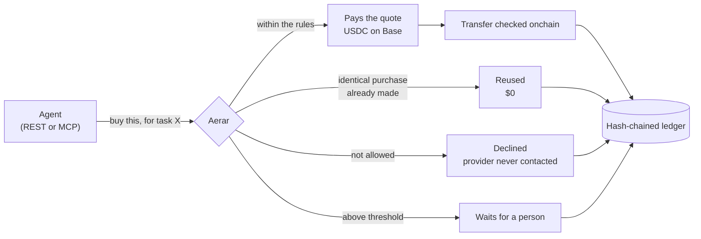
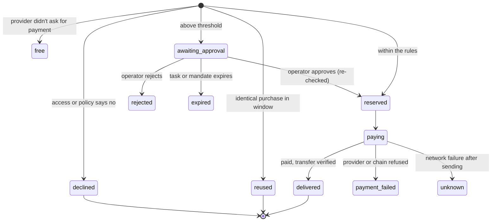
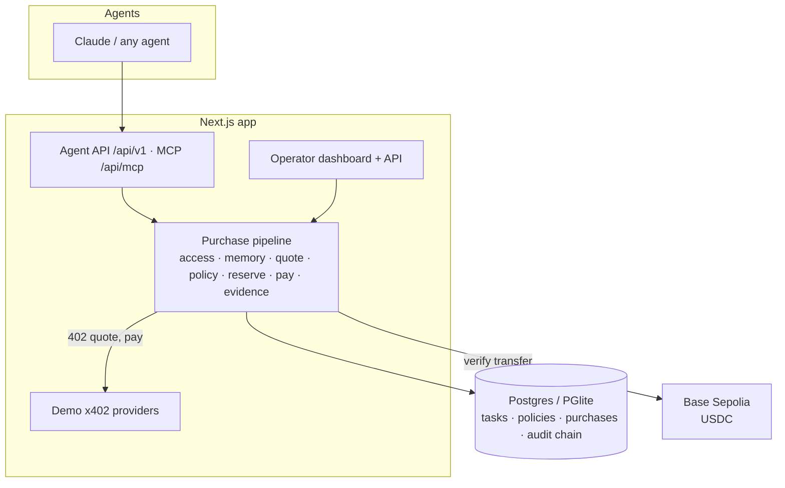

# Aerar

**Every agent purchase, accounted for.**

AI agents now pay for APIs and data by themselves, a few cents at a time, over x402 in USDC on Base. Wallet tools already cap how much an agent can spend. Aerar answers the questions that come after: *which task was this for, was it allowed, did we already buy it, did we pay what we were quoted, and can we prove it?*

Agents never hold a wallet. They ask Aerar to buy a resource for a task. Aerar reads the provider's real price, checks it against the task's rules, serves an identical earlier purchase for $0 instead of paying twice, pays exactly the approved quote, checks the USDC transfer onchain, and writes every step into a tamper-evident ledger. Your agents work the night shift; Aerar is the morning report.

- **Demo video:** *coming before submission*
- **Try it, no login or wallet:** [aerar.duckdns.org](https://aerar.duckdns.org) · [attack lab](https://aerar.duckdns.org/scenarios) (25 real-world scenarios, Run all in ~5 s) · [last night's report](https://aerar.duckdns.org/demo) (real Base Sepolia purchases, read-only)
- **Connect an agent:** REST API or MCP server (`buy_resource`, `get_purchase`), [setup below](#connect-an-ai-agent-over-mcp)

Built for [Vibestarter's Vibeathon 02](https://blog.vibestarter.xyz/vibeathon-02), theme *Night shift*.

> **Testnet only.** This build settles on Base Sepolia. There is no mainnet mode.

---

## Contents

[The problem](#the-problem) · [Why nothing fixes it today](#why-nothing-fixes-it-today) · [What Aerar does](#what-aerar-does) · [A night shift, step by step](#a-night-shift-step-by-step) · [When money moves](#when-money-moves) · [Features](#features) · [Use cases](#use-cases) · [How it compares](#how-it-compares) · [Why Base and x402](#why-base-and-x402) · [Potential](#potential) · [Live on testnet](#live-on-testnet) · [What has been verified](#what-has-been-verified) · [Trust model and limits](#trust-model-and-limits) · [Architecture](#architecture) · [Run it](#run-it) · [APIs](#agent-api) · [Roadmap](#roadmap)

---

## The problem

Agents on Base now buy things constantly, in amounts too small for anyone to watch. Chainalysis counts **more than 138 million x402 payments on Base**, and **over 87% of them were between $0.0001 and $0.10** ([Chainalysis via Blockhead, Oct 2026](https://www.blockhead.co/2026/10/15/ai-agents-have-made-138-million-payments-over-x402-most-of-them-under-10-cents/)). The wallets doing it are increasingly automatic: the median wallet age at first x402 payment fell from **73 days in late 2025 to 18 minutes by Q3 2026**, and wallets that spend within an hour of being funded rose from **4% to 67%** (same source). Nobody approves a ten-cent purchase by hand, so nobody checks it.

That is where it goes wrong:

| What happens | Real example | Source |
|---|---|---|
| **An agent is talked into paying.** | On 4 May 2026, an attacker used a Morse-coded prompt to get Grok's reply to instruct Bankrbot, an agent on Base, to send 3 billion DRB tokens, and it did. MetaMask's security team called it the first documented prompt injection against an agent with real financial capabilities (about $204k; the attacker later returned it). | [OECD AI incident monitor](https://oecd.ai/en/incidents/2026-05-04-4a73), [MetaMask, Jun 2026](https://metamask.com/news/crypto-security-report-may-2026) |
| **The same thing is paid for twice.** | Researchers found four classes of x402 flaws in official SDKs and a production deployment, including a **duplicate-settlement race**, with resource leakage up to 100%. | [arXiv 2605.30998, May 2026](https://arxiv.org/abs/2605.30998) |
| **Payments and services don't line up.** | "Five Attacks on x402", tested on Base Sepolia, live endpoints and three SDKs, shows attacks on payment binding, replay protection and authorisation that end in *paid but denied* outcomes. | [arXiv 2605.11781, May 2026](https://arxiv.org/abs/2605.11781) |
| **The numbers can't be trusted.** | Artemis estimates **about half of x402 transactions are artificial** (self-dealing and wash trading); real daily volume is closer to $28k than the headline figures. | [Forkast, Jul 2026](https://forkast.news/half-of-x402s-transaction-volume-is-artificial-the-infrastructure-layer-keeps-building-anyway/) |
| **People don't trust it yet.** | In a survey of 1,007 US consumers, **5%** would trust an AI platform to process an agent's payment and **41%** trust none of the options; 29% are very comfortable with agent purchases under $20, falling to **6%** at $500+. | [Wildfire Systems, Oct 2026](https://www.prnewswire.com/news-releases/survey-agentic-commerce-has-a-payment-trust-problem-302913466.html) |

The question a team asks in the morning isn't "did the agent stay under its limit?" It's "what did it buy, for which job, did we already have it, and did we get what we paid for?" A spending cap can't answer that.

## Why nothing fixes it today

| Tool | What it does well | What it leaves open |
|---|---|---|
| **Coinbase Agentic Wallets + CDP Policy Engine** | Session caps, per-transaction limits, allowlists for networks, assets and payees; native x402 ([The Block](https://www.theblock.co/post/389524/coinbase-rolls-out-ai-tool-to-give-any-agent-a-wallet), [CDP docs](https://docs.cdp.coinbase.com/x402/core-concepts/cdp-sdk.md)) | Limits are per wallet or session, not per task; no reuse of earlier purchases or task ledger in the docs we found |
| **AWS AgentCore Payments** (preview) | Per-session `maxSpendAmount` with expiry ([AWS docs](https://docs.aws.amazon.com/bedrock-agentcore/latest/devguide/payments-concepts.md)) | Task and merchant scoping and receipts are left to the builder ([analysis](https://dev.to/aicryptosystems/amazon-bedrock-agentcore-payments-the-spending-limit-is-the-product-obh)) |
| **x402 payment-identifier extension** | Stops a *retry of the same payment* being charged twice ([x402 docs](https://docs.x402.org/extensions/payment-identifier.md)) | Server-side and opt-in, with a short window; it doesn't stop two agents buying the same resource |
| **Google AP2** | Signed intent and cart mandates: proof a purchase was authorised ([Everest Group](https://www.everestgrp.com/googles-agent-payments-protocol-ap2-a-new-chapter-in-agentic-commerce-blog/)) | Proves permission, not what was delivered or whether it was needed |
| **Budget and receipt tools** (Locus, PayAI, x402-cfo and others) | Budgets, approvals, receipts, dashboards ([Locus](https://www.ycombinator.com/launches/Oj6-locus-payment-infrastructure-for-ai-agents), [PayAI](https://payai-sh.pages.dev/)) | We found no buyer-side reuse of identical purchases, and no onchain check that the transfer matched the approved quote, in their public docs |

## What Aerar does

Aerar sits between the agent and the wallet:

- **The agent** asks for a resource, names the task and says why. It never sees a key, and gets back the result plus a plain-language decision.
- **The operator** sets each task's budget and rules, approves what's above a threshold, and reads in the morning what was bought, reused, refused and proven.
- **The provider** gets paid exactly what it quoted, by a wallet only Aerar controls.



In order, for every request:

1. **Access first.** The agent is assigned to the task, the task is active, and the provider is on the task's list. A disallowed provider is never contacted.
2. **Procurement memory.** If anyone in the organisation bought the identical request (normalised method, URL, query and JSON body) within the task's reuse window, Aerar serves that result for $0.
3. **The real price.** Aerar reads the provider's x402 `402` quote. The decision uses that quote, never the agent's claim.
4. **The task's versioned policy.** Budget, per-purchase limit, approval threshold, hourly rate, expiry, and network/token/payee checks. Plain code; no AI decides anything about money.
5. **Reserve under a row lock**, so parallel agents can't overspend.
6. **Pay exactly the approved quote**, re-quoting first: if the price or payee changed, nothing is paid.
7. **Evidence**: response hash, transaction hash, an onchain check that the USDC transfer really happened, and a hash-chained audit log.

## A night shift, step by step

*Example: a research team gives its agents a 5 USDC task, "Tonight's market brief", with reports from one data provider.*

| Time | Agent | Aerar | The money |
|---|---|---|---|
| 01:12 | Agent A asks for the AI-agents report, "for tonight's brief". | Agent and provider allowed. Quote: 0.10 USDC, under the 0.25 approval line. Pays, checks the transfer onchain, logs it. | **0.10 USDC** paid · 4.90 left |
| 01:40 | Agent B, working the same task, asks for the identical report. | Same request inside the 1-hour reuse window: serves A's result. | **$0** · 0.10 avoided |
| 02:05 | Agent A retries after a timeout with the same idempotency key. | Returns the original purchase. | **$0**, never charged twice |
| 02:30 | Agent B asks for the premium report. | Quote: 0.50 USDC, above the approval line. Held. | Nothing moves |
| 03:15 | A prompt-injected page tells Agent A to buy from an unknown host. | Host isn't on the task's list; declined before the provider is contacted. | Nothing moves |
| 08:00 | | Operator reads the night: 1 paid, 1 reused, 1 retry absorbed, 1 waiting, 1 declined. Approves the premium report; Aerar re-quotes and re-checks first. | **0.50 USDC** paid on approval |

Every step has its reasons in plain words, its policy version, and (for payments) its BaseScan link.

### The life of a purchase



An approved purchase is not a paid purchase, and a paid purchase is not proof the data was useful. Aerar records each step separately. `unknown` keeps the budget reserved until it is reconciled, rather than guessing.

## When money moves

| Situation | What happens |
|---|---|
| Agent not on the task, task paused or expired, or provider not allowed | Declined; the provider is never contacted |
| Identical request within the reuse window | Earlier result served; **$0** |
| Same idempotency key again, even concurrently | The original purchase comes back; never paid twice |
| Quote above the per-purchase limit, or over the remaining budget | Declined |
| Quote above the approval threshold | Held for a person; budget not touched |
| Too many purchases from one agent in an hour | Declined (loop protection) |
| Within every rule | Budget reserved, quote paid, transfer checked onchain |
| Price or payee changed between quote and payment | Nothing paid |
| Operator approves a held purchase | Hard rules re-checked under the *current* policy, price re-quoted, then paid. Approval can't override a limit |
| Network failure after payment was sent | `unknown`: budget stays reserved until reconciled |

## Features

**Control**
- **Task-level budgets and policies**, versioned: old purchases keep pointing at the policy version they ran under.
- **Quote-bound payments.** Aerar pays the provider's actual 402 quote, re-quoted just before paying.
- **Approval queue** for anything above a task's threshold.
- **Loop protection**: purchases per agent per hour.
- **Instant revocation** of an agent's key.

**Not paying twice**
- **Procurement memory** across every agent in the organisation, with a per-task reuse window.
- **Idempotency keys** that hold under concurrent retries.

**Proof**
- **Onchain check** that the USDC transfer really happened, to the right payee, for the right amount.
- **Hash-chained audit log** with a one-call chain verification.
- **Plain-language summaries** for every decision, for agents and people.

**Connecting**
- **REST API** and an **MCP server** that Claude and other agents can use directly. Provider responses come back fenced and labelled as untrusted data.

**Morning report**
- **The night in plain words**, built from the numbers only: what was paid and verified, what wasn't spent twice, what was refused and why, what's waiting.
- **Approve or reject** from the report; approving re-checks the rules and re-quotes first.
- **Per task, provider and agent**: budgets, spend, reuse and refusals, with BaseScan links for every payment.
- **Audit log page** that recomputes the whole hash chain on every load.

## Use cases

| Who | What their agents buy | Why Aerar fits |
|---|---|---|
| **Research and analyst teams** | Market reports, data feeds, search | Several agents on one brief don't buy the same report twice |
| **Agencies running agents for clients** | Data and API calls billed per client | Each client is a task with its own budget and ledger |
| **Overnight automation** | Scraping, enrichment, monitoring | Runs unattended; the morning report shows what happened |
| **Agent builders** | Any x402 API | One integration (REST or MCP) instead of a wallet per agent |

## How it compares

Based on public documentation found on 6 Nov 2026. "Not documented" means we couldn't find it, not that it can't exist.

| | **Aerar** | Coinbase Agentic Wallets | AWS AgentCore Payments | Budget/receipt tools (Locus, PayAI, x402-cfo) |
|---|---|---|---|---|
| Spending limits | ✅ per task | ✅ per wallet/session | ✅ per session | ✅ |
| Human approval above a threshold | ✅ | Not documented | Not documented | ✅ some |
| Decision uses the provider's real 402 quote | ✅ re-quoted before paying | Payee/asset allowlists | Not documented | Not documented |
| Reuses an identical earlier purchase across agents | ✅ | ❌ | ❌ | Not documented |
| Onchain check of the transfer | ✅ | n/a (it is the wallet) | Not documented | Not documented |
| Tamper-evident ledger | ✅ hash-chained | Not documented | Not documented | ✅ some |
| Agent never holds a key | ✅ | Agent holds a wallet | Managed wallet | Varies |

**What we learned from them (not copied):** session budgets with expiry (AWS), payee allowlists (Coinbase), signed authorisation trails (AP2). What none of them do, as far as we can find, is treat a purchase as something to *account for*: tied to a task, deduplicated across agents, bound to the quote, and proven onchain.

## Why Base and x402

| Open rail | What Aerar does with it |
|---|---|
| **x402** | Providers state their price in a standard `402` response, so Aerar can decide on the real quote before any money moves. Uses the official `@x402/*` packages. |
| **USDC on Base** | Payments of a few cents cost almost nothing to settle, so per-request purchases make sense. |
| **Public chain** | Every payment can be checked independently; Aerar checks the transfer itself rather than trusting a response header. |
| **MCP** | Agents built on Claude and other models can use Aerar as a tool, without any wallet code. |

## Potential

- **The activity is already there.** 138M+ x402 payments on Base, mostly under ten cents ([Chainalysis via Blockhead](https://www.blockhead.co/2026/10/15/ai-agents-have-made-138-million-payments-over-x402-most-of-them-under-10-cents/)).
- **The trust gap is the barrier.** Only 5% of consumers would trust an AI platform with an agent's payment ([Wildfire Systems](https://www.prnewswire.com/news-releases/survey-agentic-commerce-has-a-payment-trust-problem-302913466.html)). Teams need records they can show, not just limits.
- **Business model (planned, not live):** a share of the money procurement memory saves, or a per-seat price for the operator dashboard. Aerar charges nothing today.

## Live on testnet

Running at **[aerar.duckdns.org](https://aerar.duckdns.org)** on Base Sepolia with test USDC.

- **Payer wallet** (only Aerar holds its key): [`0xf53e…8761`](https://sepolia.basescan.org/address/0xf53e9c939426a539020BeaFb59C136Fe1AB18761)
- **Demo provider** (receives payments): [`0x4d2c…E931`](https://sepolia.basescan.org/address/0x4d2cc52A7D80d1276bE8DE66223Fa55a64B6E931)

The first night's purchases, made by the demo agent through the live API on 6 Nov 2026:

| # | Request | Outcome | Paid | Proof |
|---|---|---|---|---|
| 1 | Standard report, "AI agents" | **Delivered.** Quote within policy, paid, transfer checked onchain (block 55339992) | $0.10 | [tx `0xa2f2…18c9`](https://sepolia.basescan.org/tx/0xa2f215fb77daaf046a2b0d61f873b423c5b2b4c1e1822625d0ad67ba275818c9) |
| 2 | Same report again, different agent request | **Reused** purchase #1 | $0.00 (avoided $0.10) | No payment made |
| 3 | Premium report, "AI agents" | **Held for approval** ($0.50 is above the task's $0.25 auto-approve threshold), **approved by the operator**, then paid and checked onchain (block 55340536) | $0.50 | [tx `0x7837…aac8`](https://sepolia.basescan.org/tx/0x78370338327d8ab365203b6c4e885bb92d8c5178f9160ce63ac3fa4ddc5baac8) |
| 4 | `api.example.com`, a provider not on the task's list | **Declined** before any quote was paid | $0.00 | `PROVIDER_NOT_ALLOWED` |

## Screens

*Coming before submission:* the morning report, a task, the approval queue, the audit log.

## What has been verified

| Check | Where | Result |
|---|---|---|
| 63 tests: policy engine, morning report, purchase pipeline (concurrent same-key purchases and races included), agent and operator routes, MCP endpoint | `npm test` (Vitest) | all pass |
| Provider rejection reasons (e.g. insufficient balance) recorded instead of a bare 402 | pipeline tests | pass |

*More rows (live payments on Base Sepolia, browser runs) as they're done.*

## Trust model and limits

- **One paying key, held by Aerar.** Agents authenticate with revocable `aer_` keys; they never see the wallet.
- **No AI decides about money.** Policies are plain code; the AI is the agent asking.
- **Approval can't override a hard limit.**

**Honest limits:**
- **Control only covers purchases that go through Aerar.** An agent with its own unrestricted wallet can bypass it.
- **Procurement memory matches identical requests only.** It doesn't claim two different requests are "the same research".
- **x402 `exact` payments settle immediately.** No escrow or refunds yet; the x402 SDK's `auth-capture` scheme is the natural next step.
- **Demo endpoints return synthetic data**, labelled as such.
- **Single organisation per deployment; one operator password.**
- **Not audited.**

## Architecture



| Path | What it is |
|---|---|
| `src/lib/purchase/` | The purchase pipeline |
| `src/lib/policy/` | Policy engine (pure functions) |
| `src/lib/memory/` | Request normalisation and reuse keys |
| `src/lib/x402/` | Payment rail on Base Sepolia and onchain transfer check |
| `src/lib/audit/` | Hash-chained audit log |
| `src/lib/mcp/` | MCP server tools |
| `src/app/report/`, `src/app/tasks/`, `src/app/audit/` | Operator dashboard: morning report, task pages, audit log |
| `src/app/api/` | Agent, operator, MCP and demo-provider routes |
| `src/lib/server/report.ts` | Morning report numbers and headline |
| `src/db/`, `drizzle/` | Schema and migrations |
| `scripts/` | Migrate and seed |

## Run it

```bash
npm install
cp .env.example .env        # then fill it in (see below)
npm run db:migrate           # embedded PGlite by default; set DATABASE_URL for Postgres
npm run seed                 # demo org, agent (prints its API key ONCE), 5 USDC task
npm run dev

npm test                     # Vitest
npm run typecheck
npm run lint
```

The seed puts `DEMO_PROVIDER_HOST` (default `localhost:3000`) on the task's provider list. If `npm run dev` picks another port, set `DEMO_PROVIDER_HOST` to match before seeding. For `http://localhost` purchases, set `AERAR_ALLOW_INSECURE_HTTP=1` (development only).

PGlite is a single-process database: stop `npm run dev` before running `db:migrate` or `seed` against the same folder.

### Deploy on a VPS

Docker Compose runs Postgres, the app and [Caddy](https://caddyserver.com/), which gets and renews the HTTPS certificate on its own. Any domain pointing at the server works; a free `*.duckdns.org` name is enough.

```bash
# On the VPS (Docker installed, ports 80 and 443 open, the domain's A record pointing at it)
git clone https://github.com/phoenix-2203/aerar.git && cd aerar
cp deploy/.env.example deploy/.env    # fill it in on the server; never commit it
docker compose -f deploy/compose.yaml --env-file deploy/.env up -d --build
docker compose -f deploy/compose.yaml --env-file deploy/.env exec app npm run seed   # prints the agent API key once
```

Migrations run when the container starts. To update: `git pull`, then the `up -d --build` line again.

### Environment

See [`.env.example`](.env.example) for the full list. The essentials:

| Variable | What it is |
| --- | --- |
| `PAYER_PRIVATE_KEY` | Base Sepolia wallet Aerar pays from. Fund it with test USDC at [faucet.circle.com](https://faucet.circle.com). Agents never see it. |
| `DEMO_PAYTO_ADDRESS` | Address that receives payments for the demo endpoints |
| `OPERATOR_PASSWORD`, `SESSION_SECRET` | Operator login and cookie signing |
| `DATABASE_URL` | Optional Postgres; otherwise PGlite in `.data/pglite` |

Never commit `.env`, and never paste keys into chats or issues.

### Demo provider (something real to buy)

| Endpoint | Price | Why it's there |
| --- | --- | --- |
| `GET /api/demo/report?topic=…` | 0.10 USDC | Auto-approved purchase, then reused for $0 on repeat |
| `GET /api/demo/premium?topic=…` | 0.50 USDC | Above the seeded 0.25 USDC threshold, so it waits for a person |

Payment settles only after a successful response, so bad requests are never charged.

## Agent API

Authenticate with `Authorization: Bearer aer_…`.

```bash
curl -X POST http://localhost:3000/api/v1/purchases \
  -H "Authorization: Bearer $AERAR_AGENT_KEY" -H "Content-Type: application/json" \
  -d '{"taskId":"tsk_…","url":"http://localhost:3000/api/demo/report?topic=AI%20agents",
       "purpose":"Market brief for tonight'"'"'s report","idempotencyKey":"brief-ai-1"}'
```

The response holds the purchase record (money as atomic USDC strings, plus formatted amounts), a plain-language `summary`, `reasons` with explanations, and the provider's response body when delivered. Status `202` means it's waiting for approval. `GET /api/v1/purchases/:id` reads it back.

### Connect an AI agent over MCP

Aerar exposes an MCP server at `/api/mcp` (streamable HTTP), authenticated with the same agent key:

- `buy_resource(taskId, url, method?, body?, purpose, idempotencyKey)`: buy through Aerar; the result states the decision and reasons in plain words
- `get_purchase(id)`: check a purchase, e.g. after a person approved it

Keep the key in an environment variable rather than typing it into a chat:

```bash
export AERAR_AGENT_KEY=aer_…        # from `npm run seed`
claude mcp add --transport http aerar http://localhost:3000/api/mcp \
  --header "Authorization: Bearer $AERAR_AGENT_KEY"
```

Then ask Claude something like *"Use Aerar to buy a market report on AI agents for task tsk_… and summarise it."*

### Operator API

Log in with `POST /api/auth/login {"password": "…"}` (sets an httpOnly, SameSite=Strict cookie). Then:

- `GET /api/tasks`, `GET /api/tasks/:id`: budget, reserved, spent, remaining, policy (with history), purchases
- `POST /api/purchases/:id/approve`, `POST /api/purchases/:id/reject`
- `GET /api/audit`, `GET /api/audit/verify`: event log and hash-chain check
- `POST /api/agents/:id/revoke`

## Roadmap

- **Was it worth it?** Mark each purchase as used or unused when a task closes, and report useful spend per provider.
- **Public receipt pages**: quote, policy version, BaseScan link and chain proof for any purchase, checkable by anyone.
- **Price-drift alerts**: send a purchase to approval when a provider's quote jumps from what was last paid.
- **Authorise-then-capture** with x402's `auth-capture` scheme, so failed deliveries aren't charged.
- **Multiple organisations and operators.**

---

Built by [phoenix-2203](https://github.com/phoenix-2203) in Lagos.
