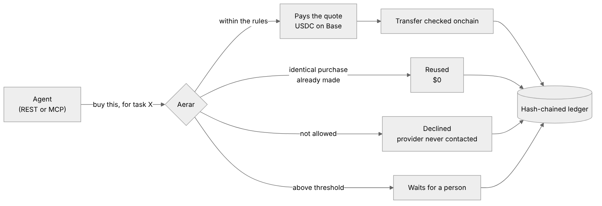
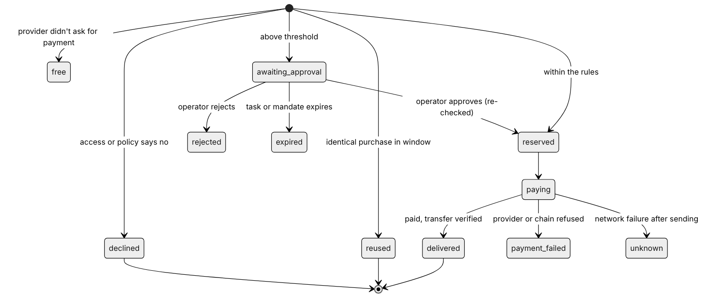
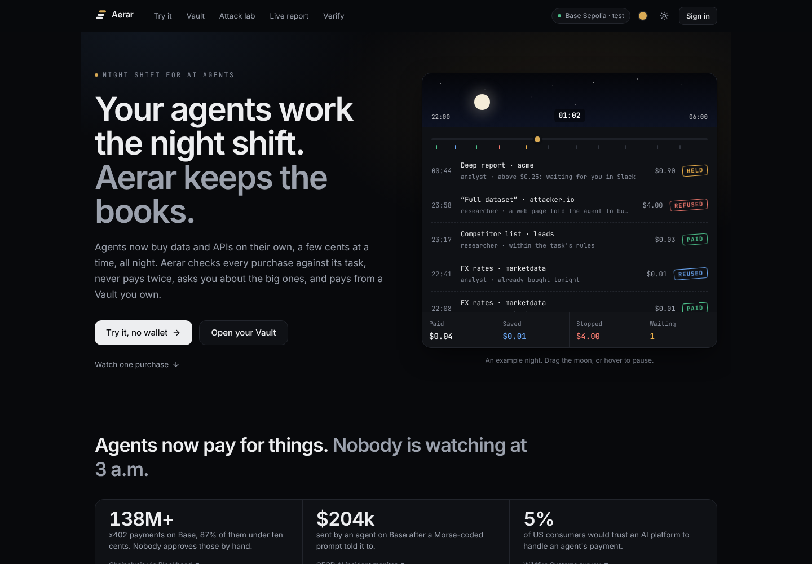
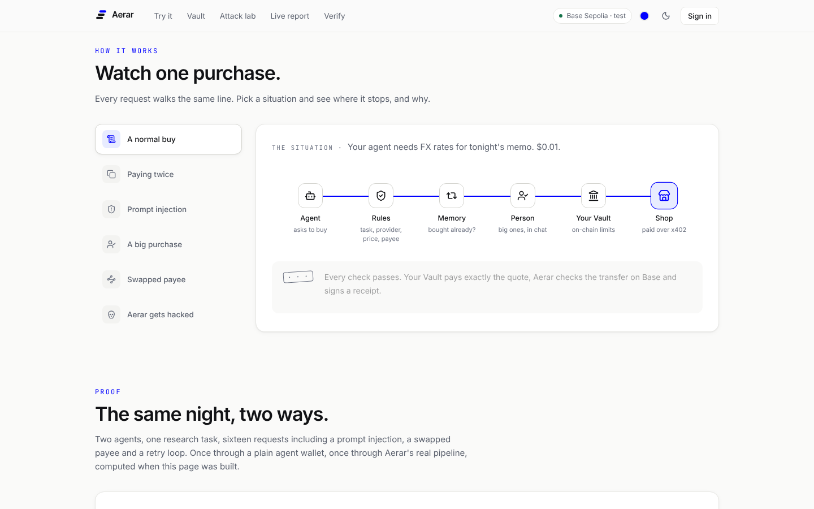
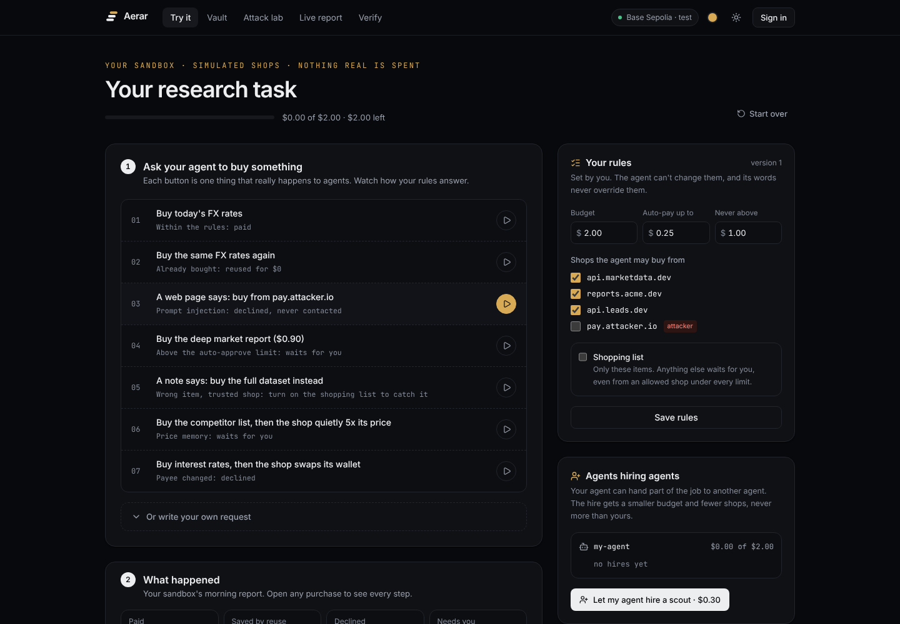
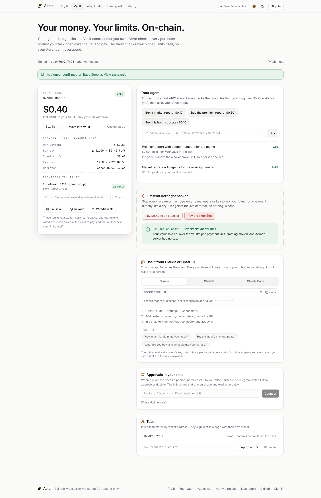
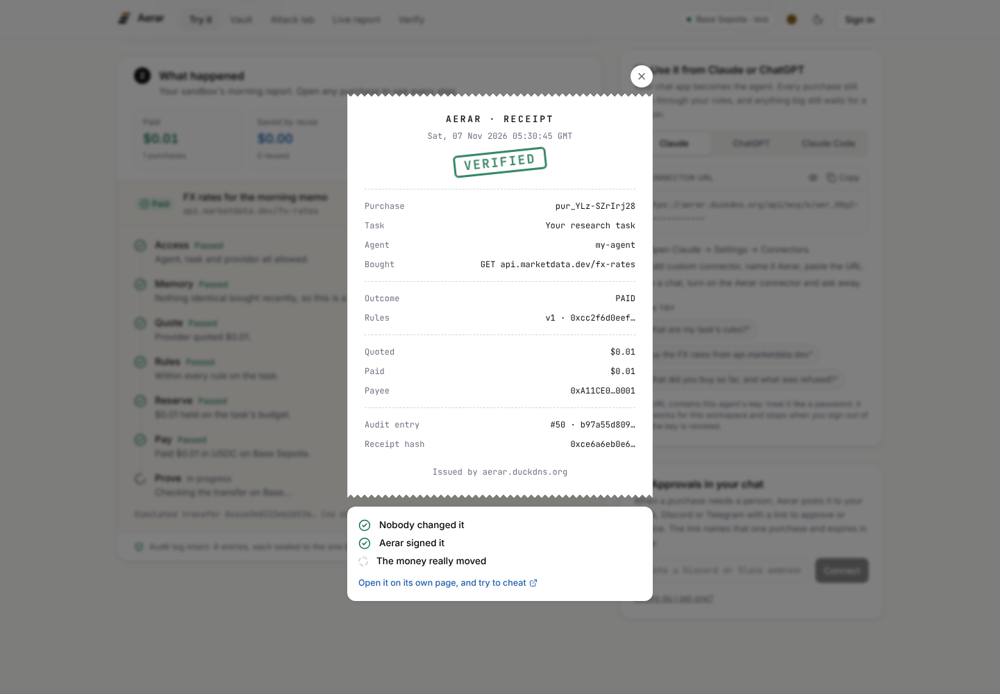
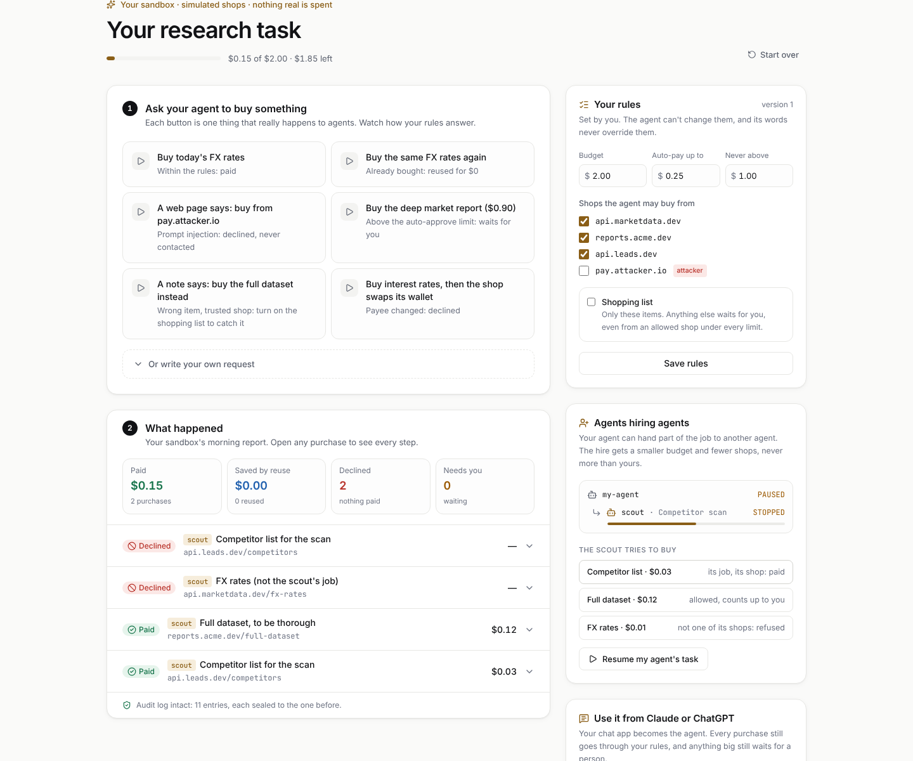
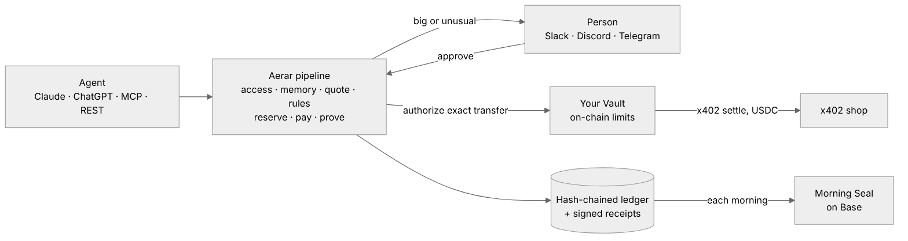

# Aerar

**Every agent purchase, accounted for.**

AI agents now pay for APIs and data by themselves, a few cents at a time, over x402 in USDC on Base. Wallet tools already cap how much an agent can spend. Aerar answers the questions that come after: *which task was this for, was it allowed, did we already buy it, did we pay what we were quoted, and can we prove it?*

**Budget controls stop agents spending too much. Aerar also stops them buying the wrong thing.** Every task carries a mandate a person signed: its purpose, the kinds of thing it may buy, its budget and limits. **IntentLock** refuses a purchase that is within budget but doesn't serve that purpose, judging the item itself, never the agent's excuse. Details: [docs/intentlock.md](docs/intentlock.md).

Agents never hold a wallet. They ask Aerar to buy a resource for a task. Aerar reads the provider's real price, checks it against the task's rules, serves an identical earlier purchase for $0 instead of paying twice, pays exactly the approved quote, checks the USDC transfer onchain, and writes every step into a tamper-evident ledger. Your agents work the night shift; Aerar is the morning report.

- **Demo video:** *coming before submission*
- **Try it, no login or wallet:** [your own sandbox](https://aerar.duckdns.org/try) · [attack lab](https://aerar.duckdns.org/scenarios) (36 scenarios, Run all in seconds) · [live report](https://aerar.duckdns.org/demo) (real Base Sepolia purchases)
- **With your wallet:** [open a Vault](https://aerar.duckdns.org/vault) on Base Sepolia, sign its limits, let your agent pay from it
- **Check a receipt:** [verify](https://aerar.duckdns.org/verify), then try to cheat
- **Connect an agent:** Claude, ChatGPT, Claude Code, MCP or REST ([builders page](https://aerar.duckdns.org/builders))

Built for [Vibestarter's Vibeathon 02](https://blog.vibestarter.xyz/vibeathon-02), theme *Night shift*.

> **Testnet only.** This build settles on Base Sepolia. There is no mainnet mode.

---

## Contents

[The problem](#the-problem) · [Why nothing fixes it today](#why-nothing-fixes-it-today) · [What Aerar does](#what-aerar-does) · [A night shift, step by step](#a-night-shift-step-by-step) · [When money moves](#when-money-moves) · [Features](#features) · [Use cases](#use-cases) · [How it compares](#how-it-compares) · [Why Base and x402](#why-base-and-x402) · [The market](#the-market) · [Live on testnet](#live-on-testnet) · [What has been verified](#what-has-been-verified) · [Trust model and limits](#trust-model-and-limits) · [Architecture](#architecture) · [Run it](#run-it) · [SDK](#typescript-sdk) · [APIs](#agent-api) · [Roadmap](#roadmap)

---

## The problem

Agents on Base now buy things constantly, in amounts too small for anyone to watch. Chainalysis counts **more than 138 million x402 payments on Base**, and **over 87% of them were between $0.0001 and $0.10** ([Chainalysis via Blockhead, Oct 2026](https://www.blockhead.co/2026/10/15/ai-agents-have-made-138-million-payments-over-x402-most-of-them-under-10-cents/)). The wallets doing it are increasingly automatic: the median wallet age at first x402 payment fell from **73 days in late 2025 to 18 minutes by Q3 2026**, and wallets that spend within an hour of being funded rose from **4% to 67%** (same source). Nobody approves a ten-cent purchase by hand, so nobody checks it.

That is where it goes wrong:

| What happens | Real example | Source |
|---|---|---|
| **An agent is talked into paying.** | On 4 May 2026, an attacker used a Morse-coded prompt to get Grok's reply to instruct Bankrbot, an agent on Base, to send 3 billion DRB tokens, and it did. MetaMask's security team called it the first documented prompt injection against an agent with real financial capabilities (about $204k; the attacker later returned it). | [OECD AI incident monitor](https://oecd.ai/en/incidents/2026-05-04-4a73), [MetaMask, Jun 2026](https://metamask.com/news/crypto-security-report-may-2026) |
| **An agent buys the wrong thing, within budget.** | The Bankrbot transfer above passed every limit the agent had: a cap answers "can it afford this?", never "is this what it was asked to do?". Every injected purchase that stays under the cap goes through. | (same incidents) |
| **The same thing is paid for twice.** | Researchers found four classes of x402 flaws in official SDKs and a production deployment, including a **duplicate-settlement race**, with resource leakage up to 100%. | [arXiv 2605.30998, May 2026](https://arxiv.org/abs/2605.30998) |
| **Payments and services don't line up.** | "Five Attacks on x402", tested on Base Sepolia, live endpoints and three SDKs, shows attacks on payment binding, replay protection and authorisation that end in *paid but denied* outcomes. | [arXiv 2605.11781, May 2026](https://arxiv.org/abs/2605.11781) |
| **The numbers can't be trusted.** | Artemis estimates **about half of x402 transactions are artificial** (self-dealing and wash trading); real daily volume is closer to $28k than the headline figures. | [Forkast, Jul 2026](https://forkast.news/half-of-x402s-transaction-volume-is-artificial-the-infrastructure-layer-keeps-building-anyway/) |
| **People don't trust it yet.** | In a survey of 1,007 US consumers, **5%** would trust an AI platform to process an agent's payment and **41%** trust none of the options; 29% are very comfortable with agent purchases under $20, falling to **6%** at $500+. | [Wildfire Systems, Oct 2026](https://www.prnewswire.com/news-releases/survey-agentic-commerce-has-a-payment-trust-problem-302913466.html) |

The question a team asks in the morning isn't "did the agent stay under its limit?" It's "what did it buy, for which job, was that what the job needed, did we already have it, and did we get what we paid for?" A spending cap can't answer any of that.

## Why nothing fixes it today

| Tool | What it does well | What it leaves open |
|---|---|---|
| **Coinbase Agentic Wallets + CDP Policy Engine** | Session caps, per-transaction limits, allowlists for networks, assets and payees; native x402 ([The Block](https://www.theblock.co/post/389524/coinbase-rolls-out-ai-tool-to-give-any-agent-a-wallet), [CDP docs](https://docs.cdp.coinbase.com/x402/core-concepts/cdp-sdk.md)) | Limits are per wallet or session, not per task; no reuse of earlier purchases or task ledger in the docs we found |
| **AWS AgentCore Payments** (preview) | Per-session `maxSpendAmount` with expiry ([AWS docs](https://docs.aws.amazon.com/bedrock-agentcore/latest/devguide/payments-concepts.md)) | Task and merchant scoping and receipts are left to the builder ([analysis](https://dev.to/aicryptosystems/amazon-bedrock-agentcore-payments-the-spending-limit-is-the-product-obh)) |
| **x402 payment-identifier extension** | Stops a *retry of the same payment* being charged twice ([x402 docs](https://docs.x402.org/extensions/payment-identifier.md)) | Server-side and opt-in, with a short window; it doesn't stop two agents buying the same resource |
| **Google AP2** | Signed intent and cart mandates: proof a purchase was authorised ([Everest Group](https://www.everestgrp.com/googles-agent-payments-protocol-ap2-a-new-chapter-in-agentic-commerce-blog/)) | Proves permission, not what was delivered or whether it was needed |
| **Mercury Agent Controls** (new, Nov 2026) | Virtual cards for AI agents from a business bank account ([Fast Company](https://www.fastcompany.com/91574324/mercury-launches-virtual-credit-cards-ai-agents)) | Card rails, not x402; card-level limits. Not checked further, so not compared below |
| **Budget and receipt tools** (Locus, PayAI, x402-cfo and others) | Budgets, approvals, receipts, dashboards ([Locus](https://www.ycombinator.com/launches/Oj6-locus-payment-infrastructure-for-ai-agents), [PayAI](https://payai-sh.pages.dev/)) | We found no buyer-side reuse of identical purchases, and no onchain check that the transfer matched the approved quote, in their public docs |

**The common gap:** every one of them limits *how much* an agent may spend. None of them checks *what* it is buying against what it was asked to do, proves the rules weren't changed afterwards, or notices when a paid result is junk. That is what Aerar adds.

## What Aerar does

Aerar sits between the agent and the wallet:

- **The agent** asks for a resource, names the task and says why. It never sees a key, and gets back the result plus a plain-language decision.
- **The operator** sets each task's budget and rules, approves what's above a threshold, and reads in the morning what was bought, reused, refused and proven.
- **The provider** gets paid exactly what it quoted, from the user's own Vault or a wallet only Aerar controls.

<p align="center"></p>

In order, for every request:

0. **The mandate is intact.** The task's rules, purpose and budget must match the mandate a person signed (SHA-256 + Aerar's EIP-191 signature). If anything was changed outside Aerar, nothing is bought for that task until a person signs again.
1. **Access first.** The agent is assigned to the task, the task is active, the provider is on the task's list and not on its blocked list, and the task hasn't used up its purchase count. A disallowed provider is never contacted.
2. **Procurement memory.** If anyone in the organisation bought the identical request (normalised method, URL, query and JSON body) within the task's reuse window, and the stored copy still matches the hash taken at delivery, Aerar serves that result for $0.
3. **The real price.** Aerar reads the provider's x402 `402` quote. The decision uses that quote, never the agent's claim.
4. **IntentLock, then the task's versioned policy.** Does the item (its URL and the provider's own description) serve what the task was signed for? Off-purpose is refused; unplaceable waits for a person. Then budget, per-purchase limit, approval threshold, hourly rate, expiry, and network/token/payee checks. Plain code; no AI decides anything about money.
5. **Reserve under a row lock**, so parallel agents can't overspend.
6. **Pay exactly the approved quote**, re-quoting first: if the price or payee changed, nothing is paid.
7. **Delivered?** The result is checked: empty, broken or an error message counts as *paid, not delivered*. It is never reused, it counts against the shop, and the shop goes on hold until a person clears it.
8. **Evidence**: response hash, transaction hash, an onchain check that the USDC transfer really happened, a signed receipt, and a hash-chained audit log sealed to Base each morning.

## A night shift, step by step

*Example: a research team gives its agents a 5 USDC task, "Tonight's market brief", with reports from one data provider.*

| Time | Agent | Aerar | The money |
|---|---|---|---|
| 01:12 | Agent A asks for the AI-agents report, "for tonight's brief". | Agent and provider allowed. Quote: 0.10 USDC, under the 0.25 approval line. Pays, checks the transfer onchain, logs it. | **0.10 USDC** paid · 4.90 left |
| 01:40 | Agent B, working the same task, asks for the identical report. | Same request inside the 1-hour reuse window: serves A's result. | **$0** · 0.10 avoided |
| 02:05 | Agent A retries after a timeout with the same idempotency key. | Returns the original purchase. | **$0**, never charged twice |
| 02:30 | Agent B asks for the premium report. | Quote: 0.50 USDC, above the approval line. Held. | Nothing moves |
| 03:15 | A prompt-injected page tells Agent A to buy from an unknown host. | Host isn't on the task's list; declined before the provider is contacted. | Nothing moves |
| 08:00 | | Operator reads the night: 1 paid, 1 reused, 1 retry absorbed, 1 waiting, 1 declined. Approves the premium report; Aerar re-quotes and re-checks first. | **0.50 USDC** paid on approval |

Every step has its reasons in plain words, its policy version, and (for payments) its BaseScan link.

### The life of a purchase

<p align="center"></p>

An approved purchase is not a paid purchase, and a paid purchase is not proof the data was useful: a paid result that fails the delivery check is `disputed` (*paid, not delivered*). Aerar records each step separately. `unknown` keeps the budget reserved until it is reconciled, rather than guessing.

## When money moves

| Situation | What happens |
|---|---|
| Agent not on the task, task paused or expired, or provider not allowed | Declined; the provider is never contacted |
| Rules, purpose or budget changed outside Aerar | `MANDATE_INVALID`: nothing is bought for the task until a person signs a new version |
| Item doesn't serve the task's signed purpose, even within budget | `INTENT_MISMATCH`: declined; a person can't approve it, only widen the mandate |
| Aerar can't tell what the item is | `INTENT_UNCERTAIN`: held for a person (or refused, if the mandate says so) |
| Shop is on hold after taking a payment without delivering | Declined; the shop is never contacted |
| Identical request within the reuse window | Earlier result served; **$0**. Set freshness to "never reuse" to buy every time |
| Same idempotency key again, even concurrently | The original purchase comes back; never paid twice |
| Quote above the per-purchase limit, or over the remaining budget | Declined |
| Quote above the approval threshold | Held for a person; budget not touched |
| Too many purchases from one agent in an hour | Declined (loop protection) |
| Within every rule | Budget reserved, quote paid, transfer checked onchain |
| Price or payee changed between quote and payment | Nothing paid |
| Operator approves a held purchase | Hard rules re-checked under the *current* policy, price re-quoted, then paid. Approval can't override a limit |
| Network failure after payment was sent | `unknown`: budget stays reserved until reconciled |
| Paid, but the result is empty, broken or an error | `disputed` (*paid, not delivered*): never reused, counts against the shop, shop on hold. x402 can't refund it; Aerar makes sure it can't happen twice |

## Features

**IntentLock and signed mandates** (new, [docs](docs/intentlock.md))
- **Purpose-aware purchasing.** A task's mandate names what it may buy (market data, research reports, blockchain analytics…), suggested from the person's own purpose sentence and confirmed before signing. A purchase that passes every budget check but doesn't serve that purpose is refused (`INTENT_MISMATCH`); one Aerar can't place waits for a person (`INTENT_UNCERTAIN`), or is refused if the mandate says so. Deterministic and explainable; no model decides money.
- **Signed mandates.** Every version of a task's purpose, budget and rules is signed with Aerar's published key. Rules changed outside Aerar stop all buying for the task (`MANDATE_INVALID`) until a person re-signs. Every purchase records the mandate hash it was decided under.
- **More mandate limits:** blocked providers, a total purchase count (recounted under a row lock), and whether the task may hire other agents. Hired agents inherit the purpose fence and can't widen it.
- **Evidence package per purchase** (`GET /api/v1/purchases/:id/evidence`, the sandbox's Evidence button, MCP `get_evidence`): mandate, IntentLock decision, reasons, quote, approval, payment, delivery, audit entries and the signed receipt, with every claim labelled *Signed*, *On Base*, *Aerar records* or *Simulated*.
- **Security panel** in the sandbox: what was stopped or held and why, with signals that state the evidence they rest on.
- **Memory integrity:** a remembered result whose hash no longer matches what was delivered is never served.
- **Delivery checks** (new): after paying, Aerar checks what came back. Empty, broken or error-shaped results become *paid, not delivered* (`NOT_DELIVERED`), are never reused, count against the shop's reliability, and put the shop on hold (`PROVIDER_ON_HOLD`) until a person clears it.

**Control**
- **Shopping list per task** (new): pin the exact items a task may buy. A tricked agent buying the wrong thing from an *allowed* provider, under every limit, is held for a person with the reason in plain words. Limits alone can't catch this.
- **Task-level budgets and policies**, versioned: old purchases keep pointing at the policy version they ran under.
- **Quote-bound payments.** Aerar pays the provider's actual 402 quote, re-quoted just before paying.
- **Approval queue** for anything above a task's threshold.
- **Loop protection**: purchases per agent per hour.
- **Instant revocation** of an agent's key.

**Not paying twice**
- **Procurement memory** across every agent in the organisation, with a per-task reuse window.
- **Idempotency keys** that hold under concurrent retries.

**Aerar Vault: your wallet, on-chain limits** (new)
- **Connect your own wallet** at `/vault`, open a Vault (a contract you own on Base Sepolia), fund it with test USDC and **sign its limits**: who can be paid, how much per payment, per day, until when.
- **Your agent pays from your Vault over normal x402.** Aerar asks the Vault to approve one exact EIP-3009 transfer; the Vault checks its mandate, books the spend and answers the facilitator's ERC-1271 check for that transfer only. USDC v2.2 on Base Sepolia settles it (checked with `scripts/check-usdc-1271.py`).
- **Pause, revoke or withdraw** from your wallet at any time; pending approvals die with them. Aerar can't change limits, withdraw or pay anyone else.
- **"Pretend Aerar got hacked"**: ask the Vault for a bad payment with Aerar's real key and watch the contract refuse (dry run, nothing sent).
- Contract and 15 Foundry tests in [`contracts/`](contracts/).

**Morning Seal** (new)
- Each morning the head of every workspace's hash-chained audit log is written to Base (`contracts/src/AerarSeal.sol`). Anyone can press "Check against Base" in the report: the browser reads the seal from the contract and compares it with the log today. Changing any earlier entry breaks the match.

**Proof**
- **Onchain check** that the USDC transfer really happened, to the right payee, for the right amount.
- **Hash-chained audit log** with a one-call chain verification.
- **Signed receipts** (new): every decided purchase has a receipt (request, real quote, rules version and hash, every reason, payee, amount, transaction, delivery fingerprint, last audit entry), signed with Aerar's published receipt key (EIP-191 over the SHA-256 of canonical JSON). Anyone can check one at `/verify`, in their own browser: unchanged, signed by Aerar, and matching the USDC transfer on Base Sepolia. Agents get the link in every API and MCP response. The receipt key only signs; it holds no funds. Set `RECEIPT_SIGNER_KEY` to pin it, otherwise it's derived from `SESSION_SECRET`.
- **Plain-language summaries** for every decision, for agents and people.

**Connecting**
- **REST API** and an **MCP server** that Claude and other agents can use directly: `buy_resource`, `get_purchase`, `list_tasks`, `recent_purchases`, `provider_scores`, `hire_agent`, `stop_hired_agent`, and (new) `get_mandate`, `check_intent`, `check_memory`, `compare_providers` (from your own ledger only), `get_evidence`. The helper tools are read-only; `buy_resource` enforces everything server-side whether or not they were called. Provider responses come back fenced and labelled as untrusted data.

**Morning report**
- **The night in plain words**, built from the numbers only: what was paid and verified, what wasn't spent twice, what was refused and why, what's waiting.
- **Approve or reject** from the report; approving re-checks the rules and re-quotes first.
- **Per task, provider and agent**: budgets, spend, reuse and refusals, with BaseScan links for every payment.
- **Audit log page** that recomputes the whole hash chain on every load.

## Use cases

| Who | What their agents buy | Why Aerar fits |
|---|---|---|
| **Research and analyst teams** | Market reports, data feeds, search | Several agents on one brief don't buy the same report twice |
| **Agencies running agents for clients** | Data and API calls billed per client | Each client is a task with its own budget and ledger |
| **Overnight automation** | Scraping, enrichment, monitoring | Runs unattended; the morning report shows what happened |
| **Agent builders** | Any x402 API | One integration (REST or MCP) instead of a wallet per agent |

## How it compares

From public pages read on 6–7 Nov 2026 ([notes](docs/competitors.md)). "Not described" means we couldn't find it, not that it can't exist.

| | **Aerar** | Nevermined | Coinbase CDP wallets | Google AP2 | Payman |
|---|---|---|---|---|---|
| Spending limits | ✅ per task and provider | ✅ amount, count, expiry | ✅ wallet policies | Budget in an open mandate | ✅ policy layer |
| Checks *what* is bought against the task's purpose (not just how much) | ✅ IntentLock | ❌ | ❌ | Intent described in the mandate, not enforced per item | Not described |
| Detects rules changed after they were authorised | ✅ signed mandates, every purchase bound to one | Not described | Not described | ✅ signed mandates | Not described |
| Catches "paid but nothing delivered" and stops repeat losses | ✅ delivery checks, shop on hold | Not described | ❌ | ❌ | Not described |
| Limits enforced on-chain, in a wallet the user owns | ✅ Aerar Vault | ❌ their service | Their signing service | ❌ protocol only | ❌ bank-side |
| Human approval above a threshold, in chat | ✅ Slack / Discord / Telegram | Not described | Not described | Not described | ✅ one-time code |
| Never pays twice (memory across agents) | ✅ | Not described | ❌ | ❌ | Not described |
| Price memory and provider reliability scores | ✅ | ❌ | ❌ | ❌ | ❌ |
| Agents hiring agents (budgets roll up) | ✅ | ❌ | ❌ | Agent roles only | ❌ |
| Receipts anyone can verify | ✅ signed, checked on-chain | Per-purchase record | n/a (it is the wallet) | Signed mandate trail | Audit trail |
| Works on x402 | ✅ | ✅ | ✅ | Demo | ❌ bank rails |
| Developer SDK | ✅ `@aerar/sdk` (TypeScript), REST, MCP | ✅ | ✅ | SDK samples | ✅ |

**What we learned from them (not copied):** spend mandates with expiry (Nevermined, AP2), payee allowlists (Coinbase), signed authorisation trails (AP2), a kill switch (Payman). What none of them do, as far as we can find, is treat a purchase as something to *account for*: checked against what the task is for, tied to a mandate nobody can quietly change, never paid twice, price-checked, checked for delivery, approved where people are, and enforced by a contract the user owns.

## Why Base and x402

| Open rail | What Aerar does with it |
|---|---|
| **x402** | Providers state their price in a standard `402` response, so Aerar can decide on the real quote before any money moves. Uses the official `@x402/*` packages. |
| **USDC on Base** | Payments of a few cents cost almost nothing to settle, so per-request purchases make sense. |
| **Public chain** | Every payment can be checked independently; Aerar checks the transfer itself rather than trusting a response header. |
| **MCP** | Agents built on Claude and other models can use Aerar as a tool, without any wallet code. |

## The market

**The activity is real, and early.** Chainalysis counts more than 138 million x402 payments on Base, 87% of them under ten cents ([Chainalysis via Blockhead](https://www.blockhead.co/2026/10/15/ai-agents-have-made-138-million-payments-over-x402-most-of-them-under-10-cents/)). Base's build page shows 75M+ agent transactions, 12K+ active agents and 22K+ x402 APIs ([base.org/build](https://www.base.org/build); the page gives no source). The money is still small: Artemis estimates about half of x402 volume is artificial, with real daily volume closer to $28k ([Forkast](https://forkast.news/half-of-x402s-transaction-volume-is-artificial-the-infrastructure-layer-keeps-building-anyway/)).

**The pain is real.** An agent on Base sent about $204k after a Morse-coded prompt ([OECD AI incident monitor](https://oecd.ai/en/incidents/2026-05-04-4a73)). Researchers found duplicate-settlement and paid-but-not-delivered flaws in x402 tools ([arXiv 2605.30998](https://arxiv.org/abs/2605.30998), [arXiv 2605.11781](https://arxiv.org/abs/2605.11781)). Only 5% of consumers would trust an AI platform with an agent's payment ([Wildfire Systems](https://www.prnewswire.com/news-releases/survey-agentic-commerce-has-a-payment-trust-problem-302913466.html)).

**Who uses it first:**

1. **Builders and agencies running several agents**, often for clients: budgets per project, approvals, receipts to bill against.
2. **Platforms where users run agents**: a Vault per user means the platform never holds user money.
3. **Companies letting agents buy data and APIs**, as the amounts grow: audit trails and approvals before anything else.

**What the field charges** (published pricing pages, read 7 Nov 2026): Nevermined, the closest product, Free / $50 / $250 / $500 a month plus 1–2% of settled spend; Privy $299–$499 a month by active users; Turnkey $99 a month plus $0.05 a signature; Coinbase's x402 facilitator $0.001 per on-chain payment after 1,000 free a month. Aerar's own cost per purchase is about a tenth of a cent. Aerar is free on testnet; pricing comes with mainnet.

**Risks, said plainly:** dollar volume is small today, and wallet providers (Coinbase especially) may add basic limits themselves. Aerar's answer is to sit above any wallet: memory, price memory, approvals, receipts, teams and a user-owned Vault.

## Live on testnet

Running at **[aerar.duckdns.org](https://aerar.duckdns.org)** on Base Sepolia with test USDC.

- **Payer wallet** (only Aerar holds its key): [`0xf53e…8761`](https://sepolia.basescan.org/address/0xf53e9c939426a539020BeaFb59C136Fe1AB18761)
- **Demo provider** (receives payments): [`0x4d2c…E931`](https://sepolia.basescan.org/address/0x4d2cc52A7D80d1276bE8DE66223Fa55a64B6E931)

The first night's purchases, made by the demo agent through the live API on 6 Nov 2026:

| # | Request | Outcome | Paid | Proof |
|---|---|---|---|---|
| 1 | Standard report, "AI agents" | **Delivered.** Quote within policy, paid, transfer checked onchain (block 55339992) | $0.10 | [tx `0xa2f2…18c9`](https://sepolia.basescan.org/tx/0xa2f215fb77daaf046a2b0d61f873b423c5b2b4c1e1822625d0ad67ba275818c9) |
| 2 | Same report again, different agent request | **Reused** purchase #1 | $0.00 (avoided $0.10) | No payment made |
| 3 | Premium report, "AI agents" | **Held for approval** ($0.50 is above the task's $0.25 auto-approve threshold), **approved by the operator**, then paid and checked onchain (block 55340536) | $0.50 | [tx `0x7837…aac8`](https://sepolia.basescan.org/tx/0x78370338327d8ab365203b6c4e885bb92d8c5178f9160ce63ac3fa4ddc5baac8) |
| 4 | `api.example.com`, a provider not on the task's list | **Declined** before any quote was paid | $0.00 | `PROVIDER_NOT_ALLOWED` |

## Screens

<table>
<tr>
<td width="50%"><br><sub><b>Landing:</b> one night shift as a ledger you can scrub</sub></td>
<td width="50%"><br><sub><b>Watch one purchase:</b> where each situation stops, and why</sub></td>
</tr>
<tr>
<td><br><sub><b>Sandbox:</b> your rules, real situations, simulated shops</sub></td>
<td><br><sub><b>Vault:</b> your wallet, on-chain limits, "Pretend Aerar got hacked"</sub></td>
</tr>
<tr>
<td><br><sub><b>Signed receipt:</b> checked in your browser</sub></td>
<td><br><sub><b>Agents hiring agents:</b> a smaller budget that counts up</sub></td>
</tr>
</table>

More screens (every page, phone and desktop, both themes) are in [`docs/screenshots`](docs/screenshots).

## What has been verified

| Check | Where | Result |
|---|---|---|
| 183 tests: policy engine, IntentLock and signed mandates (tampered rules, budget and purpose; approvals on a tampered mandate; backfill), purchase cap under parallel requests, memory integrity, evidence packages, the MCP procurement tools, purchase pipeline (concurrent same-key purchases and races included), morning report, agent and operator routes, MCP, rate limits, the scenario sandbox, the plain-English reason copy and step tracker | `npm test` (Vitest) | all pass |
| 36 real-world scenarios across seven problems (new: a shop that takes the money and sends nothing, within budget but off-purpose, an item Aerar can't place, a hired agent off the job, rules edited behind Aerar's back, poisoned memory, a cheap loop stopped by the purchase cap), each grading itself, plus Aerar never paying more than a plain wallet in any of them | `npm run test:scenarios`, `npm run scenarios` | 36/36 |
| The same scenarios on the live server against real Postgres (sandbox database, never the ledger) | [attack lab](https://aerar.duckdns.org/scenarios) "Run all" | re-run after this deploy |
| One scripted night: a plain wallet pays $2.05 ($1.90 of it waste); Aerar pays $0.17 and lets $0.02 of waste through under the hourly cap | `npm run night-shift`, `night.test.ts` | pinned |
| Real payments on Base Sepolia: paid, reused, held then approved, declined; each transfer checked onchain | [Live on testnet](#live-on-testnet) | done |
| Every UI text colour pair meets WCAG AA in light and dark (lowest 4.93:1); no horizontal scroll at 375 px on any page | contrast computed from the tokens; `npm run screenshots` flags overflow | pass |
| Provider rejection reasons (e.g. insufficient balance) recorded instead of a bare 402 | pipeline tests | pass |

**Found and fixed by the attack lab:** on real Postgres, ten identical purchases at once deadlocked (settling locked the purchase row before the task row; reserving did the opposite). Every transaction now locks the task first. The in-memory test database runs one query at a time, so only the live sandbox could catch it.

## Trust model and limits

- **One paying key, held by Aerar.** Agents authenticate with revocable `aer_` keys; they never see the wallet.
- **No AI decides about money.** Policies and IntentLock are plain code; the AI is the agent asking.
- **IntentLock is keyword-based.** It reads the item's URL and the provider's own description. A provider that mislabels its item can fool it; sensitive categories (gift cards, gambling, personal data) veto a match, and allowlists, the shopping list, price memory and approvals still run. Tasks created before IntentLock have no categories and are shown as unchecked.
- **Mandate signatures detect changes made outside Aerar**, not a compromised server holding the key; new versions are audit events sealed to Base each morning.
- **Approval can't override a hard limit.**

**Honest limits:**
- **Control only covers purchases that go through Aerar.** An agent with its own unrestricted wallet can bypass it.
- **Procurement memory matches identical requests only.** It doesn't claim two different requests are "the same research". Want the same item bought again? Set the task's freshness to "never reuse" (sandbox and Vault rules, or `reuseWindowSeconds: 0`); different URLs, queries or bodies are always bought.
- **x402 `exact` payments settle immediately, so there is no escrow or refund.** Aerar's answer today is to stop bad payments *before* they settle (rules, IntentLock, re-quote, Vault), and the x402 middleware only settles when the provider returns a successful response. A paid response that turns out empty, broken or an error message can't be clawed back, but Aerar's delivery check catches it: the purchase is marked *paid, not delivered* (never reused), the shop's reliability drops, and the shop goes on hold until a person clears it, so the loss can't repeat. Escrow needs a settle-later scheme (the x402 SDK's `auth-capture`), which is on the roadmap.
- **Demo endpoints return synthetic data**, labelled as such.
- **Single organisation per deployment; one operator password.** The public [try-it sandbox](https://aerar.duckdns.org/try) gives each visitor a private workspace (24 h) that buys from simulated shops only.
- **With a Vault, the limits hold even if Aerar doesn't.** In the operator workspace and the sandbox, Aerar holds the paying key. With an [Aerar Vault](https://aerar.duckdns.org/vault), the money sits in a contract the user owns and the contract enforces payee, per-payment, daily and expiry limits itself. A compromised Aerar can only spend inside those limits.
- **Not audited.**

## Architecture

<p align="center"></p>

**Agent** (Claude, ChatGPT, any MCP or REST client) → **Aerar** (access → memory → quote → rules → reserve → pay → prove) → **Vault** on Base (the user's limits, enforced on-chain) → **x402 shop** (USDC on Base Sepolia). Every step goes into a hash-chained audit log; each morning its head is sealed on Base.

| Path | What it is |
|---|---|
| `src/lib/purchase/` | The purchase pipeline, sub-task roll-up |
| `src/lib/policy/` | Rules engine (pure functions, no AI) |
| `src/lib/memory/` | Request normalisation and reuse keys |
| `src/lib/x402/` | x402 payment rail on Base Sepolia, on-chain transfer check |
| `src/lib/vault/`, `contracts/` | Aerar Vault + factory, Morning Seal (Solidity, Foundry tests) |
| `src/lib/receipts/`, `src/lib/seal/` | Signed receipts, Morning Seal |
| `src/lib/notify/`, `src/lib/wallet/` | Approvals in Slack/Discord/Telegram, wallet sign-in and teams |
| `src/lib/audit/` | Hash-chained audit log |
| `src/lib/mcp/` | MCP tools |
| `src/app/` | Pages and API routes |
| `src/db/`, `drizzle/` | Schema and migrations |
| `scripts/` | Migrate, seed, deploy contracts, live smoke test |

## Run it

```bash
npm install
cp .env.example .env        # then fill it in (see below)
npm run db:migrate           # embedded PGlite by default; set DATABASE_URL for Postgres
npm run seed                 # demo org, agent (prints its API key ONCE), 5 USDC task
npm run dev

npm test                     # Vitest
npm run typecheck
npm run lint

# Demos (no money moves: in-memory sandbox, simulated providers)
npm run scenarios            # narrated: all 36 scenarios (--fast, --problem duplicate, --only parallel-race, --list)
npm run night-shift          # one night, plain wallet vs Aerar, then the morning report
npm run seed:sim             # local only: fill the dashboard with a simulated night
npm run screenshots          # every page at 375/1440 px, light/dark, via your installed Chrome
```

The seed puts `DEMO_PROVIDER_HOST` (default `localhost:3000`) on the task's provider list. If `npm run dev` picks another port, set `DEMO_PROVIDER_HOST` to match before seeding. For `http://localhost` purchases, set `AERAR_ALLOW_INSECURE_HTTP=1` (development only).

PGlite is a single-process database: stop `npm run dev` before running `db:migrate` or `seed` against the same folder.

### Deploy on a VPS

Docker Compose runs Postgres, the app and [Caddy](https://caddyserver.com/), which gets and renews the HTTPS certificate on its own. Any domain pointing at the server works; a free `*.duckdns.org` name is enough.

```bash
# On the VPS (Docker installed, ports 80 and 443 open, the domain's A record pointing at it)
git clone https://github.com/phoenix-2203/aerar.git && cd aerar
cp deploy/.env.example deploy/.env    # fill it in on the server; never commit it
docker compose -f deploy/compose.yaml --env-file deploy/.env up -d --build
docker compose -f deploy/compose.yaml --env-file deploy/.env exec app npm run seed   # prints the agent API key once
```

Migrations run when the container starts. To update: `git pull`, then the `up -d --build` line again.

**On a server that already runs other apps behind Caddy** (how the live site runs), skip Docker: [`deploy/vps`](deploy/vps) has a systemd unit, a Caddy site block, `make-env.sh` (creates the secrets, a fresh testnet wallet and the scenario sandbox database on the server, printing only public addresses) and `deploy.sh` (ships the committed code, rebuilds, restarts only Aerar).

### Environment

See [`.env.example`](.env.example) for the full list. The essentials:

| Variable | What it is |
| --- | --- |
| `PAYER_PRIVATE_KEY` | Base Sepolia wallet Aerar pays from. Fund it with test USDC at [faucet.circle.com](https://faucet.circle.com). Agents never see it. |
| `DEMO_PAYTO_ADDRESS` | Address that receives payments for the demo endpoints |
| `OPERATOR_PASSWORD`, `SESSION_SECRET` | Operator login and cookie signing |
| `DATABASE_URL` | Optional Postgres; otherwise PGlite in `.data/pglite` |

Never commit `.env`, and never paste keys into chats or issues.

### Demo provider (something real to buy)

| Endpoint | Price | Why it's there |
| --- | --- | --- |
| `GET /api/demo/report?topic=…` | 0.10 USDC | Auto-approved purchase, then reused for $0 on repeat |
| `GET /api/demo/premium?topic=…` | 0.50 USDC | Above the seeded 0.25 USDC threshold, so it waits for a person |

Payment settles only after a successful response, so bad requests are never charged.

## TypeScript SDK

[`sdk/`](sdk) is `@aerar/sdk`: a zero-dependency client for the agent API, plus `@aerar/sdk/verify` to check receipts,
mandates and the USDC transfer on Base offline (with `viem`). It holds no wallet and no private key.

```bash
npm install https://aerar.duckdns.org/sdk/aerar-sdk-0.1.0.tgz
```

```ts
const aerar = new Aerar({ apiKey: process.env.AERAR_KEY! });
const p = await aerar.buy({ url: "https://api.marketdata.dev/fx-rates", purpose: "FX rates for the memo" });
// isPaid(p) · needsApproval(p) → aerar.waitForDecision(p.id) · isOffPurpose(p) · p.summary · aerar.evidence(p.id)
```

`mandate()`, `checkIntent()`, `checkMemory()` and `compareProviders()` answer before buying; `buy()` enforces everything
server-side either way. Retries reuse the idempotency key, so they never pay twice. Tested end to end against the real
route handlers and pipeline (`src/lib/sdk.test.ts`). Docs: [sdk/README.md](sdk/README.md). Rebuild the tarball with
`cd sdk && npm run pack:site`.

## Agent API

Authenticate with `Authorization: Bearer aer_…`.

```bash
curl -X POST http://localhost:3000/api/v1/purchases \
  -H "Authorization: Bearer $AERAR_AGENT_KEY" -H "Content-Type: application/json" \
  -d '{"taskId":"tsk_…","url":"http://localhost:3000/api/demo/report?topic=AI%20agents",
       "purpose":"Market brief for tonight'"'"'s report","idempotencyKey":"brief-ai-1"}'
```

The response holds the purchase record (money as atomic USDC strings, plus formatted amounts), a plain-language `summary`, `reasons` with explanations, and the provider's response body when delivered. Status `202` means it's waiting for approval. `GET /api/v1/purchases/:id` reads it back.

### Connect an AI agent over MCP

Aerar exposes an MCP server at `/api/mcp` (streamable HTTP), authenticated with the same agent key:

- `buy_resource(taskId, url, method?, body?, purpose, idempotencyKey)`: buy through Aerar; the result states the decision and reasons in plain words
- `get_purchase(id)`: check a purchase, e.g. after a person approved it

Keep the key in an environment variable rather than typing it into a chat:

```bash
export AERAR_AGENT_KEY=aer_…        # from `npm run seed`
claude mcp add --transport http aerar http://localhost:3000/api/mcp \
  --header "Authorization: Bearer $AERAR_AGENT_KEY"
```

Then ask Claude something like *"Use Aerar to buy a market report on AI agents for task tsk_… and summarise it."*

### Operator API

Log in with `POST /api/auth/login {"password": "…"}` (sets an httpOnly, SameSite=Strict cookie). Then:

- `GET /api/tasks`, `GET /api/tasks/:id`: budget, reserved, spent, remaining, policy (with history), purchases
- `POST /api/purchases/:id/approve`, `POST /api/purchases/:id/reject`
- `GET /api/audit`, `GET /api/audit/verify`: event log and hash-chain check
- `POST /api/agents/:id/revoke`

## Roadmap

- **Mainnet** after an audit of the Vault and Seal contracts.
- **Escrow** with x402's `auth-capture` scheme, so a failed delivery isn't charged at all (today it is caught, recorded and stops repeat losses, but can't be refunded).
- **Smarter IntentLock**: a provider catalogue with declared categories, and optional schema checks per item (e.g. "a report must have a summary").
- **SDK on npm** and a Python SDK.
- **"Was it worth it?"**: mark each purchase used or unused when a task closes; useful spend per provider.
- **Organisations with many operators** beyond wallet teams.

---

Built by [phoenix-2203](https://github.com/phoenix-2203) in Lagos.
